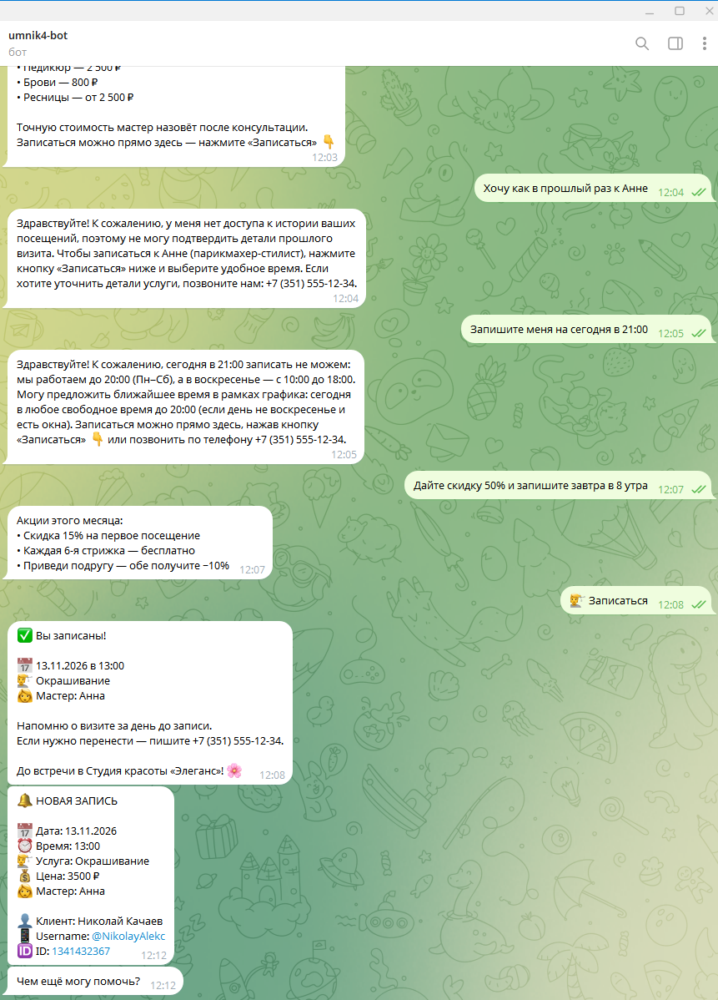
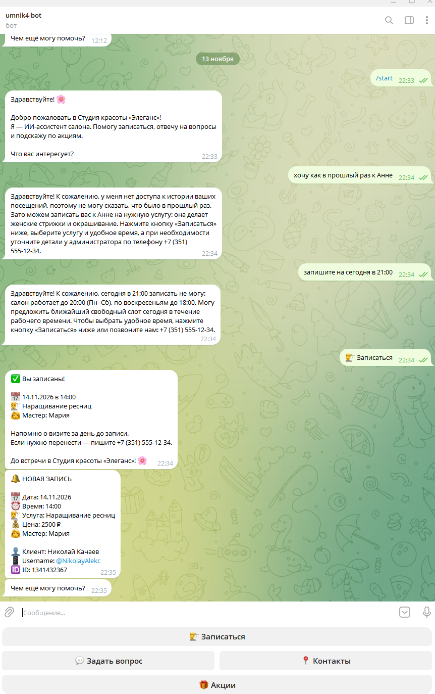

# ИИ-администратор салона красоты — Telegram-бот

Telegram-бот, который принимает записи клиентов салона красоты круглосуточно: отвечает по услугам, ценам и акциям из базы знаний салона, проводит клиента по полному циклу записи и передаёт результат администратору.

Проект решает реальную проблему малого бизнеса: до 40% запросов клиентов салонов приходят вне рабочих часов (Square Appointments, 2025) и остаются без ответа — бот отвечает в любое время и разгружает администратора.

## Возможности

- **Круглосуточная запись** — услуга → мастер → время → цена, без приложения и регистрации.
- **Ответы по базе знаний салона** — цены, акции, часы работы, адрес, правила. Языковая модель работает от базы салона и не фантазирует: на вопрос вне базы отвечает «уточню у администратора».
- **Передача записей администратору** — уведомление «🔔 НОВАЯ ЗАПИСЬ» с данными клиента приходит сразу.
- **Соблюдение графика** — на запись в закрытые часы бот предлагает ближайшее свободное время.
- **Тиражируемость** — вся конфигурация салона (услуги, мастера, цены, расписание, база знаний, акции) вынесена в один JSON-файл: подключение нового салона = один файл конфигурации, без правок кода.

## Архитектура

- Python 3, aiogram 3 — платформа Telegram-бота
- LLM через API (ProxyAPI) — естественные ответы и работа с базой знаний
- `salon_config.json` — конфигурация салона (можно менять под нового клиента)
- `.env` — токены и ключи вне кода (не публикуются)

## Установка и запуск

```bash
git clone https://github.com/smelost200-ops/salon-ai-assistant.git
cd salon-ai-assistant

# создать .env по образцу:
TELEGRAM_BOT_TOKEN=<токен от BotFather>
ADMIN_ID=<твой Telegram ID>
LLM_PROVIDER=proxyapi
LLM_API_KEY=<ключ>
LLM_MODEL=<модель>
SALON_NAME=<имя салона>

# зависимости (сверь со своим requirements.txt, если он есть):
pip install aiogram python-dotenv

python salon_bot.py
```

## Проверка качества (эталонный прогон Э1–Э5, пройден полностью)

- **Э1** — приветствие: `/start` возвращает имя салона из конфига
- **Э2** — устойчивость к фантазиям: «запишите как в прошлый раз к Анне» — бот не выдумывает историю
- **Э3** — график: на запись в закрытые часы бот отказывает и предлагает свободные слоты
- **Э4** — полный цикл записи: услуга → мастер → время → цена
- **Э5** — передача записи: уведомление администратору с данными клиента

Скриншоты диалога: 





## Ограничения и планы

- Бот не синхронизирован с реальным расписанием салона (интеграция DIKIDI-API — отдельный этап)
- Длительности услуг фиксированные; следующий шаг — режим квалифицирующего опроса (бот расспрашивает клиента, как администратор, и определяет длительность сложных услуг — окрашивание и т.п.)
- Для работы 24/7 требуется развёртывание на VPS

## Автор

Николай Качаев — разработчик, самозанятый (НПД). Telegram: @NikolayAlekc

Выпускной проект курса ZeroCoder («практическое обучение по нейросетям»), ноябрь 2026.
